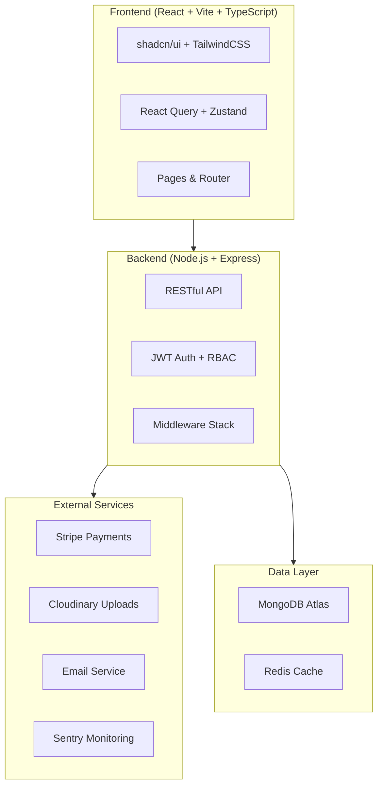

# ScholarHive - SaaS Scholarship Platform Implementation Plan

## Overview
A production-ready SaaS scholarship platform for international students featuring advanced filtering, application tracking, Stripe subscriptions, and admin moderation.

## Architecture



## Project Structure

```
SCHOLARSHIP/
├── client/                    # React frontend
│   ├── src/
│   │   ├── components/        # Reusable UI components
│   │   ├── pages/             # Route pages
│   │   ├── hooks/             # Custom hooks
│   │   ├── lib/               # Utilities, API client
│   │   ├── stores/            # Zustand stores
│   │   ├── types/             # TypeScript types
│   │   └── styles/            # Global styles
│   └── ...config files
├── server/                    # Express backend
│   ├── src/
│   │   ├── controllers/       # Route handlers
│   │   ├── services/          # Business logic
│   │   ├── models/            # Mongoose models
│   │   ├── routes/            # API routes
│   │   ├── middlewares/       # Auth, validation, etc.
│   │   ├── utils/             # Helpers
│   │   ├── config/            # App configuration
│   │   └── seeds/             # Seed data
│   └── ...config files
└── shared/                    # Shared types/constants
```

## Build Phases

### Phase 1: Foundation
- [x] Project setup (Vite + Express)
- [x] TailwindCSS + shadcn/ui configuration
- [x] MongoDB models
- [x] Authentication system (JWT + refresh tokens)
- [x] Basic middleware stack

### Phase 2: Core Features
- [x] Scholarship CRUD
- [x] Search & filtering
- [x] Application system
- [x] File uploads (Cloudinary)

### Phase 3: Dashboard & UX
- [x] Student dashboard
- [x] Provider dashboard
- [x] Admin dashboard
- [x] Profile completion system
- [x] Recommendation engine

### Phase 4: Monetization
- [x] Stripe integration
- [x] Subscription plans
- [x] Premium feature gates
- [x] Webhook handling

### Phase 5: Admin & Security
- [x] Admin moderation
- [x] Audit logging
- [x] Security hardening
- [x] Rate limiting

### Phase 6: Polish
- [x] Notifications (email)
- [x] SEO optimization
- [x] Legal pages
- [x] Seed data & env setup guide

## Database Models

| Model | Key Fields |
|-------|-----------|
| User | name, email, password, role, profile, subscriptionStatus |
| Scholarship | title, country, level, field, fundingType, deadline, status |
| Application | userId, scholarshipId, documents, status, steps |
| Payment | userId, stripeCustomerId, plan, status |
| AuditLog | action, userId, metadata, timestamp |
| Notification | userId, type, message, read |

## API Endpoints

| Method | Endpoint | Description |
|--------|----------|-------------|
| POST | /api/auth/register | Register user |
| POST | /api/auth/login | Login user |
| POST | /api/auth/refresh | Refresh token |
| GET | /api/scholarships | List scholarships |
| POST | /api/scholarships | Create scholarship |
| GET | /api/scholarships/:id | Get scholarship |
| PUT | /api/scholarships/:id | Update scholarship |
| DELETE | /api/scholarships/:id | Soft delete |
| POST | /api/applications | Submit application |
| GET | /api/applications | List applications |
| PATCH | /api/applications/:id/status | Update status |
| POST | /api/payments/checkout | Create checkout |
| POST | /api/payments/webhook | Stripe webhook |
| GET | /api/admin/users | Admin: list users |
| GET | /api/admin/analytics | Admin: analytics |
